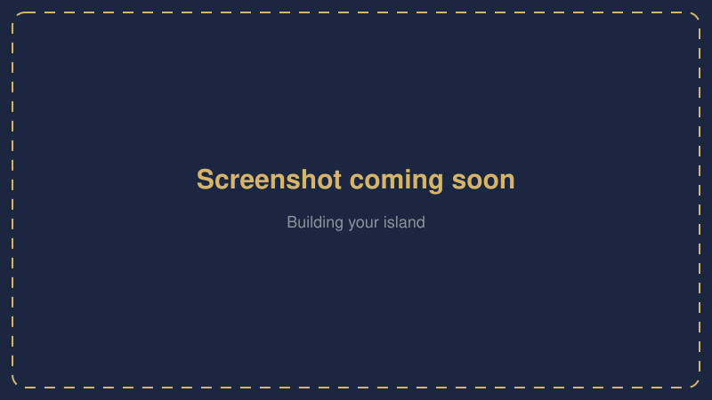
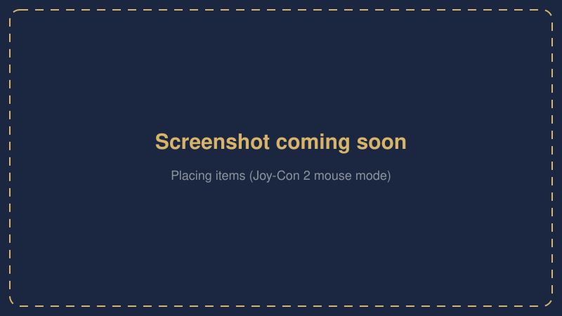
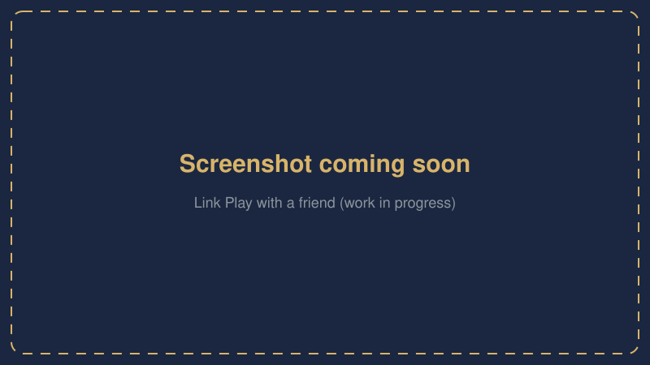
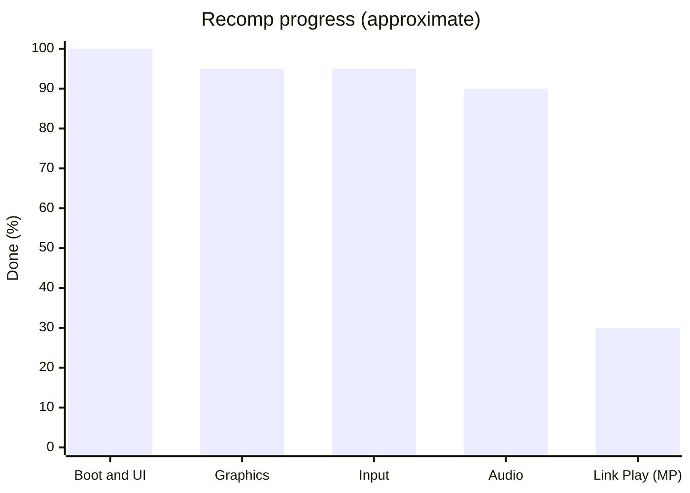

<h1 align="center">🏝️ Pokopia Recomp</h1>

  <b>Pokémon Pokopia (Switch 2) recompiled to run natively on Windows — with multiplayer support.</b> 
  You need your own extracted copy of the game, version <b>2.0.1a</b>. Not affiliated with Nintendo, The Pokémon Company or Koei Tecmo.

  
  
  
  
  
  
  
  

  

> [!TIP]
> Windows says "Windows protected your PC"? The build is not signed: click **More info**, then **Run anyway**.
>
> What changed in each version: [releases](https://github.com/featureJosh/pokopia-recomp/releases) and [CHANGELOG.md](CHANGELOG.md).

## Screenshots

<table>
  <tr>
    <td width="50%"> Title screen</td>
    <td width="50%"> Building your island</td>
  </tr>
  <tr>
    <td width="50%"> Placing items with Joy-Con 2 mouse mode</td>
    <td width="50%"> Link Play with a friend (work in progress)</td>
  </tr>
</table>

Placeholders — drop real screenshots into <code>docs/assets/screenshots/</code> and point the <code>&lt;img&gt;</code> tags at them.

## Progress

| Area | Status |
|---|---|
| Single player (`main`) | ✅ Playable — see the [latest release](https://github.com/featureJosh/pokopia-recomp/releases/latest) |
| Link Play, two players on one island (PC ↔ PC) | 🚧 Work in progress on [`experimental-coop`](https://github.com/featureJosh/pokopia-recomp/tree/experimental-coop) |

Update the chart as features land.

## Requirements

- Windows 10 or 11, 64-bit
- GPU with Vulkan 1.3
- 16 GB of RAM

## Usage

1. Unzip the build and run `PokopiaLauncher.exe`.
2. Pick your dump folder and press Set up. It compiles the game on your PC (about 7 minutes), then builds the shader cache (1 to 2 hours). You can pause it and continue later.
3. Press Play.

F1 opens the settings in game. Middle mouse toggles Joy-Con 2 mouse mode for placing items.

## Multiplayer (work in progress)

Link Play (two players on one island, PC to PC through a small relay server) is being built on the
[`experimental-coop`](https://github.com/featureJosh/pokopia-recomp/tree/experimental-coop) branch. A first session has worked, but it is not in any release yet and is
not ready to play. Builds from `main` stay offline.

## Reporting problems

[Open an issue](https://github.com/featureJosh/pokopia-recomp/issues/new/choose) with `pkp.log` from the session where it happened, your GPU and your Windows version.

## Contributing

- Open pull requests against `main` and say what you tested on which GPU.
- Code for this game goes in `recomp/games/pkp/` and `runtime/games/pkp/`; the rest is shared with other games.
- Building from source needs Visual Studio 2022 Build Tools or newer (with the C++ x64 tools and CMake), LLVM 23, PowerShell 7, Python 3.13 with [uv](https://docs.astral.sh/uv/), sccache, .NET 10 SDK, the Vulkan SDK (graphics test validation), vcpkg with `libvpx:x64-windows-static` (`C:\vcpkg` or `VCPKG_ROOT`), Rust and Node.js. The scripts find Visual Studio with vswhere.
- First build, from the repository root:
  1. `uv venv tools\.venv --python 3.13` and `uv pip install --python tools\.venv -r recomp\requirements.txt`
  2. `pwsh -File tools\textures\scripts\fetch_third_party.ps1`, then `pwsh -File tools\textures\scripts\build.ps1` (the runtime links its `astc2bc7.lib`)
  3. Put the dump in `game\dump\` as the launcher expects it (`updates\<version>\exefs` and `romfs`) or the exefs files in `game\dump\exefs\`, then `recomp\scripts\build_game.cmd pkp`
  4. `pwsh -File game-build\scripts\build.ps1`
- Shaders: [tools/shaders/README.md](tools/shaders/README.md). Launcher: `npm install`, `npm run tauri build` in `launcher\`.
- Runtime tests: `pwsh -File runtime\scripts\build.ps1 -Test`.

## Credits

Built on [nxrecomp](https://github.com/drakolordx7/nxrecomp). Uses code from [Ryujinx](https://github.com/Ryubing/Ryujinx), [Mesa](https://gitlab.freedesktop.org/mesa/mesa), smo-recomp, ScarletNX, ssbu-recomp, SuperMarioWonderRecomp, yuzu, Eden, libnx, [astc-encoder](https://github.com/ARM-software/astc-encoder), [bc7enc_rdo](https://github.com/richgel999/bc7enc_rdo), [libvpx](https://chromium.googlesource.com/webm/libvpx), AMD FidelityFX, NVIDIA Image Scaling, [SDL3](https://github.com/libsdl-org/SDL), [Tauri](https://tauri.app), [Zig](https://ziglang.org) and Python, plus [Kenney input prompts](https://kenney.nl/assets/input-prompts) and DejaVu fonts. Licences are in `runtime/THIRD_PARTY_NOTICES.md`, `recomp/THIRD_PARTY.md` and `tools/shaders/licenses/`.

## License

GPL-3.0. Third-party code keeps its own licence.
