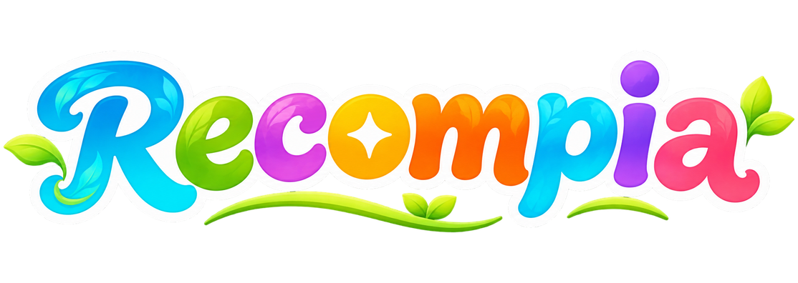

<!-- source-sha256: ca46cbecd8109a73a9c0353eb903326efef3f51d5c73908e657addcd47fdb990 -->
> Esta es una traducción automática del [README en inglés](../../README.md); puede contener errores. El README en inglés es la versión definitiva.

<h1 align="center">
  
</h1>

<h3 align="center">Recompia</h3>

<p align="center">
  <b>Un juego acogedor de simulación de vida y construcción sandbox con criaturas fantásticas (Switch 2, ID de título 0400A3A01EE4C000, versión 2.0.1a), recompilado para funcionar de forma nativa en Windows, Linux, Mac y Android, con compatibilidad con multijugador.</b>
</p>

<p align="center">
  <a href="https://github.com/Dittobyte/Recompia/releases/latest"></a>
  <a href="https://github.com/Dittobyte/Recompia/releases/latest"></a>
  <a href="https://github.com/Dittobyte/Recompia/releases">
  
  </a>
  <a href="https://github.com/Dittobyte/Recompia/releases"></a>
  
  
  
  <a href="https://github.com/Dittobyte/Recompia/commits/main"></a>
  <a href="https://github.com/Dittobyte/Recompia/issues"></a>
</p>

<p align="center">
  <a href="https://github.com/Dittobyte/Recompia/releases/latest"></a>
  <a href="https://github.com/Dittobyte/Recompia/releases/latest"></a>
  <a href="https://github.com/Dittobyte/Recompia/releases/latest"></a>
</p>

<p align="center">
  <b><a href="https://github.com/Dittobyte/Recompia/releases">Versiones</a></b> ·
  <a href="../../CHANGELOG.md">Registro de cambios</a> ·
  <a href="../../CONTRIBUTING.md">Cómo contribuir</a> ·
  <a href="../../CREDITS.md">Créditos</a> ·
  <a href="https://github.com/xFractals/pokopia-native">Proyecto original</a> ·
  <a href="../../SECURITY.md">Seguridad</a> ·
  <a href="../../LEGAL.md">Información legal</a> ·
  <a href="../../PRIVACY.md">Privacidad</a> ·
  <a href="https://github.com/Dittobyte/Recompia/issues">Problemas</a> ·
  <a href="https://discord.recompia.com">Discord</a>
</p>

> [!IMPORTANT]
> **No se incluye ningún archivo del juego.** Necesitas tu propia copia extraída de este juego acogedor de simulación de vida y construcción sandbox con criaturas fantásticas (ID de título 0400A3A01EE4C000, versión **2.0.1a**). Este proyecto no proporciona archivos del juego, claves ni herramientas de volcado. Consulta [LEGAL.md](../../LEGAL.md).

## Funciones

### Jugar juntos (Link Play)
- **Visita la isla de un amigo o invítalo a la tuya**, en la misma red Wi-Fi o por internet.
- **Juego cruzado con jugadores de [el proyecto original](https://github.com/xFractals/pokopia-native)**.
- Configúralo en la página **Link Play** del launcher. No hay que editar archivos.
- Guía paso a paso: [Jugar juntos](#playing-together).

### Importar tus partidas guardadas
- **¿Ya juegas en Eden o Ryujinx?** Un botón en **Settings** encuentra tu partida guardada y la importa. La copia de tu emulador no se modifica.
- **¿Tienes una partida guardada en otro lugar?** Elige su carpeta, la que contiene `B00`, `G00` y `S00`.
- **Tu partida guardada actual nunca se elimina.** Primero se conserva como una carpeta de copia de seguridad.
- Si no se puede escribir una partida guardada porque el disco está lleno, o OneDrive o el antivirus retienen el archivo, se conserva la última partida correcta y el juego te avisa.

### Configuración sencilla
- **Usa tu volcado tal como lo tengas:** una carpeta con `base` y `updates`, o un único archivo `.nup` o `.nx`.
- **Mensajes claros si hay algún problema con el volcado:** versión incorrecta del juego, actualización ausente o archivos dañados durante la copia. El launcher te indica qué hacer.
- **Comprobaciones antes de empezar:** espacio suficiente en disco, controlador gráfico operativo y memoria suficiente.
- **Use fewer cores** permite seguir usando el PC durante la compilación. Puedes pausar y continuar más tarde.
- **Las actualizaciones son rápidas:** solo se vuelven a compilar las partes que han cambiado.
- El launcher te avisa cuando hay una nueva versión.

### Controles
- **Cualquier mando:** Xbox, PlayStation, Switch Pro y otros, con vibración y controles de movimiento. Los botones siguen la disposición de Switch de forma predeterminada.
- **Teclado y ratón.** El ratón también funciona en los menús: haz clic para confirmar el elemento resaltado; desplázate o usa las teclas de flecha para mover el resaltado.
- **Cambia cualquier botón** en la página **Controls** de F1.
- **Los iconos de los botones en pantalla corresponden al dispositivo que estás usando:** teclado, Xbox, PlayStation, Steam Controller o Switch.
- **Escribir tu nombre** funciona con mando, ratón o teclado.
- **Sal sin Alt+F4:** mantén pulsados Select y Start (View y Menu en un mando de Xbox), o usa **Quit game** en F1.
- **Abre el menú F1 desde un mando:** pulsa los dos sticks a la vez (L3 + R3); cámbialo o desactívalo con `[overlay] pad` en `controls.ini` (`none` = desactivado). No puede ser la misma combinación usada para salir.

### Steam Deck y dispositivos portátiles
- Se reconocen Steam Deck, Legion Go S y otros dispositivos portátiles: los iconos del mando permanecen en pantalla y el tamaño de la imagen se adapta a la pantalla.
- Las pantallas 16:10 se llenan por completo, sin bandas negras.
- Funciona de forma nativa en SteamOS, con mejoras de velocidad para dispositivos portátiles (aproximadamente entre 26 y 53 fps en Steam Deck y entre 55 y 75 fps en Legion Go S, según mediciones de jugadores).
- El launcher también funciona en Linux y SteamOS: consulta [Linux, SteamOS y Steam Deck](#linux-steamos-and-the-steam-deck).

### Teléfonos y tabletas Android
- **Un solo APK para teléfonos y tabletas arm64** (Android 11 o posterior, Vulkan 1.3). No contiene archivos del juego: el juego se compila en el teléfono a partir de tu propio volcado, sin necesidad de un PC.
- **Controles táctiles o un mando.** Los controles táctiles se ocultan solos cuando se conecta un mando USB o Bluetooth. Arrastra sobre una zona vacía de la pantalla para girar la cámara.
- **Valores predeterminados elegidos para el teléfono:** la resolución, el límite de fotogramas y los ajustes de memoria se adaptan a la GPU y la memoria del teléfono en el primer inicio. Puedes cambiarlos en **Settings** de la aplicación.
- **El modo cooperativo y Link Play** también funcionan en el teléfono: consulta [Jugar juntos](#playing-together).
- Configuración y juego: consulta [Android](#android).

### Gráficos
- **Juega a cualquier resolución**, 4K y superiores. Reduce **Render scale** si funciona con lentitud.
- **Los ajustes predefinidos de calidad** (Switch 2, High, Ultra) determinan la distancia de visión y la nitidez de las texturas.
- **HDR** en pantallas HDR.
- **Ventana, sin bordes o pantalla completa.** Elige el monitor, limita la frecuencia de fotogramas y muestra un contador de FPS. Alt+Enter cambia de modo durante la partida.
- **Escaladores:** FSR 1 y NVIDIA Image Scaling funcionan.
- **FSR 3 y DLSS / DLAA están disponibles, pero todavía no ofrecen buenos resultados** y necesitan más trabajo. Déjalos desactivados por ahora.

### Ajustes dentro del juego
Pulsa **F1** en el juego para cambiar los gráficos, los controles y el sonido (volumen, dispositivo de salida y silenciar cuando la ventana esté en segundo plano). La mayoría de los cambios se aplican de inmediato.

En Android, abre el menú de pausa del juego y después **Settings**: las opciones de pantalla del teléfono están en las pestañas **Display** y **Performance** (consulta [Ajustes de Android](#android-settings)).

## Inicio rápido

1. Descarga `Recompia-<version>-windows-x64.zip` de la [última versión](https://github.com/Dittobyte/Recompia/releases/latest) y extráelo donde quieras.
2. Ejecuta `Recompia.exe`. Si SmartScreen muestra una advertencia, elige **More info → Run anyway**. Selecciona la carpeta de tu volcado y pulsa **Set up**: el juego se compila en tu PC (unos 7 minutos) y después se genera la caché de sombreadores (entre 1 y 2 horas; puedes pausar y continuar más tarde).
3. Pulsa **Play**.

F1 abre los ajustes dentro del juego. El botón central del ratón activa o desactiva el modo ratón de Joy-Con 2 (apunta y haz clic para colocar y romper bloques).

### Linux, SteamOS y Steam Deck

1. Descarga `Recompia-<version>-linux-x86_64.tar.gz` de la [última versión](https://github.com/Dittobyte/Recompia/releases/latest) y extráelo donde quieras, por ejemplo en tu carpeta personal.
2. Ejecuta `Recompia.AppImage` en esa carpeta (haz doble clic o ejecuta `./Recompia.AppImage` en una terminal). Selecciona la carpeta de tu volcado y pulsa **Set up**: la primera vez descarga sus herramientas de compilación (Python y Zig, unos 100 MB), compila el juego y después genera la caché de sombreadores. Puedes pausar y continuar más tarde.
3. Pulsa **Play**.

Nada se ejecuta mediante Proton ni Wine: el launcher, el juego, el traductor de sombreadores y las herramientas de compilación son todos programas nativos de Linux.

Si `Recompia.AppImage` no se inicia en un sistema sin FUSE, ejecuta `./Recompia.AppImage --appimage-extract-and-run`.

Para iniciar desde Steam (modo Juego en Deck): añade el launcher a Steam, bien en los Ajustes del launcher (Steam, Add to Steam) o en el modo de escritorio con **Add a Non-Steam Game**, eligiendo `Recompia.AppImage` y dejando vacías las opciones de lanzamiento. El acceso directo abre el launcher, que busca actualizaciones; después pulsa Jugar. Encontrarás más información y las pruebas realizadas en [launcher/README.md](../../launcher/README.md#linux-steamos-the-steam-deck-bazzite-other-distributions).

### Android

**Qué necesitas:**
- Un teléfono o tableta arm64 con Android 11 o posterior y Vulkan 1.3. Se ha probado en un Snapdragon 8 Gen 3 (Adreno 750). El controlador Mesa Turnip incluido admite las GPU Adreno 6xx, 7xx y 8xx (de Snapdragon 8 Gen 1 a 8 Gen 3 y 8 Elite). Se recomiendan 12 GB de RAM; los teléfonos con menos usan un [perfil de memoria baja](#common-problems). Los teléfonos con otras GPU (Exynos, Mali y otras) usan el controlador propio del teléfono y valores predeterminados prudentes, y se han probado mucho menos.
- Tu propio volcado descifrado del juego, en carpetas: la misma carpeta que acepta el launcher de PC (`base` y `updates`, o `exefs` y `romfs`). Unos 7,3 GB. La aplicación nunca descarga datos del juego y no incluye ningún archivo del juego.
- Espacio libre: unos 7,3 GB para los archivos del juego, 2,6 GB mientras se compila el juego (se quedan 0,6 GB) y 6,6 GB para los sombreadores. Traducir los sombreadores en el teléfono necesita 12 GB libres al empezar.

**Configuración:**
1. Descarga `Recompia-<version>-android-arm64.apk` de la [última versión](https://github.com/Dittobyte/Recompia/releases/latest) y ábrelo en el teléfono. Permite que tu navegador o gestor de archivos instale aplicaciones si Android lo pide.
2. Copia tu volcado al teléfono: conéctalo al PC con un cable USB, elige **File transfer** en el teléfono y copia la carpeta completa en la carpeta `Download` del teléfono. También sirve una tarjeta microSD o una unidad USB. Copia en modo binario: una copia por FTP en modo texto daña los archivos.
3. Abre Recompia y pulsa **Get started**. En **Storage access**, pulsa **Allow storage access** y permite el acceso a todos los archivos: la aplicación lee tu volcado donde está y guarda sus propios datos en `/sdcard/Recompia`.
4. En **Game files**, un volcado que esté en `Download` o en el nivel superior del almacenamiento del teléfono aparece en **Found on this phone**. Si no, pulsa **Choose a folder** y elígelo. Los archivos se comprueban y se leen donde están, no se copia nada. (Si la aplicación no puede leer una carpeta donde está, ofrece copiarla en `/sdcard/Recompia/dump`).
5. En **Build**, pulsa **Start building**. El juego se compila en el teléfono a partir de tus archivos: unos 45 minutos en un teléfono con Snapdragon 8 Gen 3 conectado al cargador, más en teléfonos más lentos o calientes. Mantén el teléfono enchufado y en un lugar fresco. La compilación continúa con la aplicación cerrada, y **Pause** conserva el trabajo terminado.
6. En teléfonos con GPU Adreno, a continuación viene el paso **Graphics driver**: pulsa **Use the included Turnip driver**. El controlador propio del teléfono muestra una imagen negra en este juego.
7. En **Shaders**, pulsa **Translate on this phone** (entre 1,5 y 2 horas aproximadamente en el mismo teléfono; se puede pausar). O bien, si tienes Recompia en un PC, copia su carpeta `shader_cache` (sin su carpeta `corpus`) en `/sdcard/Recompia/shader_cache` y pulsa **Import a shader cache from a PC install**: así te ahorras la larga traducción.
8. Pulsa **Play**.

**How to get your game files onto the phone**, en Home de la aplicación, tiene los mismos pasos.

#### Controles táctiles y mandos

- **Los controles táctiles** aparecen cuando no hay ningún mando conectado. El botón de menú en pantalla abre el menú táctil: **Hide touch controls**, **Edit layout** (arrastra un control para moverlo; toca uno y después **Smaller** o **Bigger**), **Exit to Recompia** y **Back to the game**.
- Arrastra sobre una zona vacía de la pantalla para girar la cámara; un toque breve ahí va al juego. La sensibilidad y la inversión de ejes están en **Settings** de la aplicación, **Touch camera**.
- **Los mandos** por USB o Bluetooth funcionan. Los controles táctiles se ocultan mientras haya uno conectado (**Hide when a controller is connected** en **Settings**).
- La opacidad, el tamaño, la vibración y **Reset touch layout** están en **Settings** de la aplicación, **Touch controls**.

#### Ajustes de Android

**Settings** de la aplicación contiene los ajustes de pantalla, controles táctiles, jugabilidad, Link Play y controlador de GPU; la mayoría se aplican la próxima vez que se inicia el juego. Dentro del juego, **Settings** del menú de pausa tiene estos en la pestaña **Display**:

| Ajuste | Qué hace |
|---|---|
| **Frame Rate Limit** | Cada opción es un número entero de refrescos de la pantalla. 30 de forma predeterminada; un valor más bajo funciona más fresco y estable. |
| **Resolution** | La resolución de la imagen 3D, del 15 % al 100 % de la pantalla por lado. Los menús y el texto siguen nítidos. Cambia al momento: redúcela si el teléfono se calienta o va lento. El primer inicio elige una proporción de la pantalla adecuada para la GPU del teléfono. |
| **Dynamic Resolution** | Desactivado de forma predeterminada. Baja la resolución por debajo de la anterior mientras la GPU se queda atrás, y la vuelve a subir hasta ella. **Dynamic Resolution Mode** elige **GPU Time** o **Heat** (además la mantiene por debajo de lo que evita que el teléfono reduzca su rendimiento por calor). |

Y en la pestaña **Performance**:

| Ajuste | Qué hace |
|---|---|
| **Upscaler** | **SGSR** (Snapdragon Game Super Resolution, la opción predeterminada y recomendada: más ligera y estable) da nitidez a la imagen 3D ampliada. **SGSR 2** reconstruye más detalle a lo largo de varios fotogramas, pero cuesta más y puede parpadear ligeramente en movimiento; no se ofrece en teléfonos con el perfil de memoria baja. **Off** estira la imagen. Los menús siguen nítidos en ambos casos. Se aplica al guardar los ajustes. |
| **Sharpness** | Cuánta nitidez aplica SGSR 2 a su imagen (SGSR no lo usa). Cambia al momento. |

## Mods y traducciones

Puedes superponer al juego una carpeta de archivos de reemplazo (un mod de texto o texturas, o una traducción) sin modificar el volcado del juego: **Settings > Game > Mods**, o `romfs_mod` dentro de `[fs]` en `pkp.ini`. Este proyecto no incluye ninguno; consigue el mod de su autor.

La carpeta que elijas debe tener la misma estructura que el `romfs` del juego: los mismos archivos y carpetas, empezando por el nivel superior. Sus archivos reemplazan los archivos del juego con la misma ruta, las carpetas se combinan y también se utilizan los archivos que solo existen en el mod.

```text
MyMod/                       <- choose this folder in Settings > Game > Mods
├── LD_C0_R.BIN              <- same path as in the game's romfs
├── LI_C0_R.IDX
└── motor_asset_re/
    └── ...
```

Si la descarga tiene una carpeta exterior (por ejemplo `2.0.1/romfs/...`), elige la carpeta `romfs` interior, la que contiene `LD_C0_R.BIN`, no la exterior. Si el nivel de la carpeta es incorrecto, `pkp.log` indica que ningún archivo del mod reemplaza un archivo del juego. No se admiten mods que reemplacen archivos que contienen sombreadores.

### Mods y traducciones (portugués de Brasil)

Puedes superponer al juego una carpeta de archivos de reemplazo (un mod de texto o texturas, o una traducción) sin modificar el volcado: **Settings > Game > Mods**, o `romfs_mod` dentro de `[fs]` en `pkp.ini`. Este proyecto no incluye ningún mod; pídelo a su autor.

La carpeta elegida debe tener la misma estructura que la carpeta `romfs` del juego: los mismos archivos y carpetas, empezando por el nivel superior. Sus archivos reemplazan los archivos del juego con la misma ruta, las carpetas se combinan y también se utilizan los archivos que solo existen en el mod.

Si la descarga tiene una carpeta exterior (por ejemplo `2.0.1/romfs/...`), elige la carpeta `romfs` interior, la que contiene `LD_C0_R.BIN`, no la exterior. Si el nivel de la carpeta es incorrecto, `pkp.log` indica que ningún archivo del mod reemplaza un archivo del juego. No se admiten mods que reemplacen archivos que contienen sombreadores.

## Actualizar desde una versión anterior

Tus partidas guardadas, ajustes y sombreadores se conservan.

**Desde 0.7.5 en adelante:** pulsa **Update** en Home o en Settings > About. El launcher descarga la nueva versión, la comprueba, sustituye sus propios archivos y se reinicia. Cuando la versión cambia el código del juego, el launcher primero compila el nuevo programa del juego (`pkp.exe`) junto al que ya tienes, con las propias herramientas de la nueva versión. Eso lleva desde unos minutos hasta una hora, según tu PC, y puedes seguir jugando todo el tiempo: Home muestra el progreso y la actualización se instala cuando el juego está cerrado. **Cancel** la detiene hasta entonces y no cambia nada; el siguiente **Update** continúa donde se detuvo.

**Desde 0.7.0 o una versión anterior:** descarga el nuevo zip (Windows) o `Recompia-<version>-linux-x86_64.tar.gz` (Linux) de la [última versión](https://github.com/Dittobyte/Recompia/releases/latest), cierra el juego y el launcher, y extráelo sobre tu instalación, en la misma carpeta. No contiene partidas guardadas, ajustes, caché de sombreadores ni archivos del juego, por lo que no sustituye nada de lo tuyo.

**Si Home muestra Finish update después de una actualización:** esa versión ha cambiado el código del juego y no se pudo compilar antes de la actualización (una instalación extraída a mano, o una versión anterior elegida en Settings), por lo que el launcher vuelve a compilar el programa del juego (`pkp.exe`) a partir de tus archivos del juego. También ocurre si antes omitiste una versión de este tipo y actualizas a mano más tarde. Esto lleva desde unos minutos hasta una hora, según tu PC, y se conservan los sombreadores y las partidas guardadas. No es la larga configuración inicial: los sombreadores solo se vuelven a traducir cuando lo indican las notas de la versión, y entonces solo los que han cambiado. El `pkp.exe` anterior se conserva hasta que el nuevo está listo.

Si quieres una copia de seguridad, copia primero la carpeta `save` en otro lugar. Es posible que una partida guardada escrita por una versión más reciente no se pueda cargar en una anterior.

**Android:** descarga el nuevo `Recompia-<version>-android-arm64.apk` de la [última versión](https://github.com/Dittobyte/Recompia/releases/latest) e instálalo sobre la aplicación que ya tienes. Tus partidas guardadas, ajustes, caché de sombreadores y archivos del juego en `/sdcard/Recompia` se conservan. Si después Home muestra **Set up again**, púlsalo: la nueva versión trae nuevas herramientas de compilación o una nueva interfaz del juego, así que el juego se vuelve a compilar en el teléfono. Se conservan las partidas guardadas y los sombreadores.

**Android, de 0.16 a 0.17.0:** el APK de 0.17.0 tiene para Android un número de versión inferior al de los APK de 0.16, por lo que Android se niega a instalarlo sobre 0.16. Hasta que salga una versión con la corrección ([#898](https://github.com/Dittobyte/Recompia/pull/898)), desinstala primero 0.16 y después instala 0.17.0. Desinstalar conserva todo lo que hay en `/sdcard/Recompia` (partidas guardadas, caché de sombreadores, `pkp.ini` y `controls.ini`), pero elimina lo que la aplicación guarda dentro de sí misma: el juego compilado, el controlador de GPU y los ajustes y la disposición de los controles táctiles. Después la configuración se vuelve a ejecutar: permite el acceso al almacenamiento, elige tus archivos del juego, vuelve a compilar el juego y, en teléfonos Adreno, vuelve a elegir el controlador Turnip. La caché de sombreadores se encuentra donde está.

## Jugar juntos

Link Play reúne a varios jugadores en una isla. El juego cruzado funciona con jugadores del proyecto original en la versión **2.0.1** del juego. Los jugadores con la versión 1.0.5 no pueden unirse.

**Qué ha cambiado.** Link Play ahora utiliza el protocolo cooperativo del proyecto original. No funciona con compilaciones anteriores de Link Play de este port, así que todos deben actualizarse a esta versión.

**Cada jugador necesita su propia partida guardada.** La copia de la partida guardada de otra persona no puede unirse a la partida original.

**Configuración.** En el launcher, abre **Link Play** y elige una opción:

| Opción | Para qué sirve |
|---|---|
| Off | Sin Link Play. |
| Same network | La opción predeterminada. Misma Wi-Fi o red: el anfitrión se detecta automáticamente. Si no, escribe la dirección del anfitrión, por ejemplo `192.0.2.10` (en **This PC**, en la página del anfitrión), en **Join directly**. |
| Internet | Juega por internet. Todas las salas aparecen en la lista **Visit a Friend** del juego: sin código de sala y sin nada que redirigir. |

Los cambios se aplican la próxima vez que se inicia el juego.

**Dentro del juego**, abre el PC de tu primera casa, después **Link Play** (se desbloquea al alcanzar Environment Level 2 en Withered Wasteland) y elige **Local connection**. (**Online connection** es el servicio propio de Nintendo y no funciona aquí). El anfitrión elige **Invite Others to Visit** y los demás **Visit a Friend**.

**Misma red.** Todos eligen **Same network**. Steam Deck y otros dispositivos con Proton o Linux encuentran anfitriones y también pueden ser detectados, sea cual sea su red. La Wi-Fi de cafeterías, hoteles y redes de invitados suele aislar los dispositivos: en ese caso, juega por internet.

**Por internet.** Todos eligen **Internet**. Nada que redirigir y ningún código que escribir: el launcher usa el servidor de retransmisión público del proyecto, y todas sus salas aparecen en la lista **Visit a Friend** del juego. Para una sala privada, acepta cuando el juego pida definir un **Link Code**: solo pueden unirse los jugadores que lo escriban. Tu propio servidor de retransmisión o un puerto redirigido están en **Advanced**; ahí también sirve cualquier servidor cooperativo del proyecto original, y `Recompia --host` ejecuta uno en un servidor. **[La guía de Link Play](../link-play.md)** tiene los pasos y qué comprobar cuando no conecta; [la página completa de multijugador](../multiplayer/README.md) explica los servidores de retransmisión y los puertos. El servidor de retransmisión no cifra el tráfico del juego.

**Puertos y firewall.** La primera vez que actúes como anfitrión, el Firewall de Windows preguntará por `pkp.exe`: permite **Private networks**. Tu red también debe ser privada (Settings, Network & internet, tu conexión, Network profile type: **Private**).

| Puerto | Quién lo usa | Protocolo |
|---|---|---|
| 47600 | El anfitrión | TCP y UDP |
| 47610 | El servidor de retransmisión | TCP, y UDP para la ruta más rápida |

**Interact everywhere (experimental, desactivado de forma predeterminada).** En las zonas de la historia, el juego pone a los visitantes en Spectator Mode. **Interact everywhere** les permite usar movimientos y objetos, recoger, colocar y construir allí. Todos los jugadores necesitan el mismo ajuste; de lo contrario, el anfitrión no aparece en la lista.

Link Play: unirse y caminar juntos funcionan. Consulta [docs/multiplayer](../multiplayer/README.md) para saber cómo funciona y ver las opciones de `pkp.ini`.

**En Android.** Link Play está en **Settings** de la aplicación, **Link Play**: **Same network** o **Internet**, como arriba. Los teléfonos no encuentran anfitriones en la red por sí solos: para visitar en la misma red, escribe la dirección del anfitrión; para ser anfitrión, déjala vacía. Por internet, las salas del servidor de retransmisión aparecen en **Visit a Friend**. Los cambios se aplican la próxima vez que se inicia el juego. El modo cooperativo es la tarjeta **Recompia: Co-op** de Home: únete con la invitación que comparta quien creó la partida cooperativa (el código corto `XXX-XXX`, válido durante 6 horas, o el texto largo `PKCOOP1.`), o crea ahí una nueva partida cooperativa e invita a otros. Todos juegan a través del servidor de retransmisión de la partida, y una nueva partida cooperativa empieza el juego desde cero.

## Problemas habituales

- **La ventana está negra o el juego se entrecorta mucho en el primer inicio.** El juego crea algunos sombreadores mientras se ejecuta. El launcher traduce los que ya ha visto antes de cada inicio y otra vez al salir, por lo que las primeras sesiones son irregulares y las posteriores mejoran. Dale un minuto y sigue jugando. Si la configuración se detuvo a mitad, abre **Game files** y pulsa **Set up** para continuar. Conserva el trabajo terminado.
- **Windows indica que "Smart App Control" ha bloqueado el launcher, la configuración o el juego.** Smart App Control solo ejecuta programas con firma digital o que Microsoft ya conoce, y no tiene botón **Run anyway**. El juego (`pkp.exe`) se compila en tu propio PC durante la configuración, así que nunca puede llevar firma. Desactiva Smart App Control: **Windows Security**, **App & browser control**, **Smart App Control settings**, **Off**. En algunas versiones de Windows 11 no se puede volver a activar sin restablecer Windows, así que lee el propio mensaje de Windows antes de confirmar. Después vuelve a ejecutar `Recompia.exe` y pulsa **Set up** si se detuvo.
- **El launcher indica que los archivos del juego son de una versión anterior o que falta la actualización.** Esta versión necesita 2.0.1a. Vuelve a volcar el juego con la actualización instalada. El juego base por sí solo no es suficiente.
- **El launcher indica que no encontró archivos utilizables del juego, o Set up indica que un archivo no coincide.** Elige la carpeta que contiene `base` y `updates`, por ejemplo `Game_v2.0.1a`. Cada una necesita `exefs` (`main`, `sdk`, `subsdk0`, `rtld`, `main.npdm`) y `romfs`. Un archivo que no coincide está dañado. Vuélvelo a volcar o a copiar.
- **El launcher indica que los datos del juego (romfs) están incompletos, o el juego se cerró al inicio con "pkp.exe exited with code 4".** Tu herramienta de volcado escribió el `romfs` de la actualización sin incluir debajo los archivos del juego base (una actualización solo contiene los archivos que cambia). Conserva el juego base en el mismo volcado (`base` junto a `updates`, cada uno con `exefs` y `romfs`) y elige la carpeta que contiene ambos: el launcher añade automáticamente los archivos que faltan de `base`. Después pulsa **Set up** otra vez. Si no, vuelve a volcar el juego con la actualización integrada en el juego base.
- **El launcher indica que el volcado se copió en modo texto.** Lo copiaste por FTP en modo texto, lo que daña `main`, `sdk` y `subsdk0`. Copia otra vez las carpetas `exefs` y `romfs` con el tipo de transferencia **Binary** (FileZilla: Transfer, Transfer type, Binary).
- **Tu volcado es un solo archivo** (`.nsp`, `.xci`). El launcher acepta el juego en carpetas o como paquete `.nup` o `.nx` (un `.nx` creado a partir de archivos extraídos o de un `.nup`, no directamente del `.nsp` o `.xci`). Extrae el `.nsp` o `.xci` en carpetas con tu herramienta de volcado.
- **La configuración se detiene con un error porque no se puede abrir o eliminar un archivo.** Coloca la carpeta en una ubicación sencilla, como `C:\Recompia`, no en una carpeta sincronizada por OneDrive. Es posible que el antivirus esté analizando los archivos que se están compilando: espera a que termine o permite la carpeta. **Open setup log** muestra dónde se detuvo.
- **Set up muestra una advertencia antes de empezar.** Primero comprueba el espacio libre en disco (unos 14 GB con los archivos de sombreadores empaquetados, que es lo predeterminado, o unos 31 GB con archivos sueltos), Vulkan, la memoria y el procesador. En una CPU de escritorio Intel de 13.ª o 14.ª generación, actualiza la BIOS antes de la configuración: sin la corrección de Intel, estas CPU pueden fallar durante cargas completas prolongadas. Si el PC se calienta o resulta difícil de usar durante la compilación, marca **Use fewer cores**.
- **Frecuencia de fotogramas baja o imagen borrosa.** El tamaño de la imagen se fija al iniciar el juego. Es el tamaño de la ventana o la pantalla en ese momento (**Settings**, **Display**).
  - Si empiezas en **Borderless** en una pantalla 4K, el juego dibuja a 4K. Eso exige mucho. Reduce **Render scale**.
  - Si empiezas en **Windowed** (1280x720 de forma predeterminada) y pulsas Alt+Enter, la imagen sigue siendo 720p y se amplía. Define **Window mode** antes de pulsar **Play**.
  - Ajusta **Frame rate limit** a lo que puede mostrar tu pantalla.
- **Link Play: el visitante no encuentra al anfitrión.** Elige **Visit by address** y escribe la dirección del anfitrión, que aparece en su página Link Play. Comprueba que el anfitrión haya iniciado el juego y elegido **Invite Others to Visit**, que el Firewall de Windows permita `pkp.exe` en redes privadas y que la red sea privada. La Wi-Fi de cafeterías, hoteles y redes de invitados que aísla dispositivos impide el juego LAN para todos: usa **Internet** con un servidor de retransmisión y un código de sala. Por internet, comprueba la dirección del servidor y el código de sala. Los cambios de la página Link Play se aplican la próxima vez que se inicia el juego.
- **Link Play: se rechaza la conexión.** Los jugadores no tienen contenido coincidente. Todos necesitan el juego 2.0.1, la misma versión del port (o el proyecto original para juego cruzado), los mismos mods y el mismo ajuste de **Interact everywhere**.
- **Link Play: "Communication error" (9005) al visitar.** Ambos estáis jugando con copias de la misma partida guardada, por lo que tenéis el mismo ID de jugador. Cada jugador necesita su propia partida guardada.
- **No se detecta el mando.** Abre el juego con F1 y mira la línea **Gamepad** de la página Controls. Muestra "No gamepad open" cuando el juego no detecta ninguno. Conéctalo antes de pulsar **Play** y prueba con otro cable o puerto. Cierra otros programas que puedan estar usando el mando.

**En Android:**
- **La imagen está negra en un teléfono con GPU Adreno.** El controlador propio del teléfono muestra una imagen negra en este juego. En **Settings** de la aplicación, **GPU driver**, elige **Use the included Turnip driver**. Si con un controlador el juego deja de iniciarse o se ve mal, elige ahí **Use the system driver**.
- **El teléfono tiene menos de 12 GB de memoria** (por ejemplo, teléfonos de 8 GB). La aplicación usa un perfil de memoria baja: tamaños de sombras y texturas menores, una resolución de salida más baja y unos 5 GB de almacenamiento libre como memoria adicional para el juego. Con menos almacenamiento libre, el juego se inicia sin ella y puede ser menos estable: Home lo indica. Libera algo de espacio para obtener los mejores resultados.
- **El teléfono se calienta o la frecuencia de fotogramas baja al cabo de un rato.** Los teléfonos se ralentizan cuando se calientan. Reduce **Resolution** en **Settings** del juego, **Display** (cambia al momento), o el **Frame Rate Limit**. Pon **Counter Detail** del contador de fotogramas en **Full** para ver lo caliente que está el teléfono y lo ocupadas que están la GPU y la CPU. La compilación y la traducción de sombreadores son tareas largas y pesadas: mantén el teléfono enchufado y en un lugar fresco; la aplicación avisa cuando se calienta.
- **La compilación se detuvo cuando el sistema cerró la aplicación.** Abre la aplicación y pulsa **Continue building**: el trabajo terminado se conserva.
- **Los archivos del juego no funcionan.** El paso **Game files** indica qué está mal (una versión anterior, el juego base sin la actualización, archivos que faltan o se dañaron durante la copia) y cómo solucionarlo, igual que en PC. Cada uno de `base` o `updates/<version>` necesita `exefs` y `romfs`. **Show details** muestra lo que falta.

Si ninguno de estos casos describe tu problema, consulta [Informar de problemas](#reporting-problems).

## Dónde están tus partidas guardadas, registros y ajustes

Todo esto está en la carpeta del juego: la carpeta con `Recompia.exe` y `pkp.exe`, salvo que hayas elegido otra en **Settings**, **Game folder**.

| Contenido | Ubicación |
|---|---|
| Partidas guardadas | `save` (**Settings** puede indicar otra ubicación: **Save folder**) |
| Ajustes | `pkp.ini` y `controls.ini` (F1 dentro del juego escribe `controls.ini`) |
| Registro | `pkp.log`, que se escribe en cada inicio desde el launcher. Un fallo también escribe `pkp_crash.txt`, `pkp_freeze.txt` o `pkp_fatal.txt`. |
| Sombreadores traducidos | `shader_cache` (unos 26 GB) |
| Archivos de compilación | `build` (la carpeta de trabajo de la configuración) |
| `.nup` o `.nx` desempaquetado | `nup_dump`, si elegiste un `.nup` o `.nx` (sus complementos, si los hay, en `nup_dump/aoc`) |
| Ajustes del launcher | `%APPDATA%\org.pkp-recomp.launcher\launcher.json` (las carpetas de tu volcado y del juego) |

**En Android** están en `/sdcard/Recompia` (el almacenamiento interno del teléfono, carpeta `Recompia`):

| Contenido | Ubicación |
|---|---|
| Partidas guardadas | `save` (las partidas cooperativas en `coop-saves`). **Saves** en Home las exporta como zip para un PC, o importa un zip de una carpeta de partidas guardadas de un PC. |
| Ajustes | `pkp.ini` y `controls.ini`. Los ajustes y la disposición de los controles táctiles se guardan dentro de la aplicación. |
| Registro | `logs/pkp.log`. **Logs** en Home muestra los registros más recientes y permite compartirlos o guardar una copia. |
| Sombreadores traducidos | `shader_cache` (unos 6,6 GB) |
| Archivos de compilación | `build` (la carpeta de trabajo de la compilación) |
| Archivos del juego copiados | `dump`, solo si la aplicación copió tu volcado. Si no, lee tu volcado donde está. |
| Juego compilado y controlador de GPU | dentro de la aplicación; se eliminan al desinstalarla |

**Storage** en Home muestra cuánto ocupa cada uno y permite eliminar los archivos de compilación, la caché de sombreadores, un volcado copiado o las partidas guardadas.

No adjuntes nunca archivos del juego, las carpetas `build` o `shader_cache`, ni partidas guardadas a un problema. `pkp.log` es suficiente.

## Comunidad

Preguntas, ayuda con errores, pruebas y chat: únete al [Discord de Recompia](https://discord.recompia.com). El launcher también tiene un botón **Join Discord** en **Settings > About > Community**. Los errores que necesitan una corrección se siguen informando en [GitHub](https://github.com/Dittobyte/Recompia/issues/new/choose).

## Informar de problemas

[Abre un problema](https://github.com/Dittobyte/Recompia/issues/new/choose) con el `pkp.log` de la sesión en la que ocurrió, tu GPU y tu versión de Windows (en Linux: tu distribución, la versión de Proton y el dispositivo; en Android: el chipset, la versión de Android y el controlador de GPU, con el registro compartido desde **Logs** en la aplicación).

**Linux, SteamOS y dispositivos portátiles con Linux:** yo (Jerban) me ocupo de la parte de Linux, así que los errores de Linux se corrigen y se publican rápidamente mediante el actualizador de un clic. Perdona las actualizaciones frecuentes y gracias por tu paciencia. Sigue informando de errores de Linux, siempre con tus registros: `pkp.log`, y `setup.log` para problemas con Set up (consulta [Dónde están tus partidas guardadas, registros y ajustes](#where-your-saves-logs-and-settings-are)). Josh revisa primero todo lo que no sea de Linux.

## Licencia

GPL-3.0. El código de terceros conserva su propia licencia; consulta [CREDITS.md](../../CREDITS.md).
